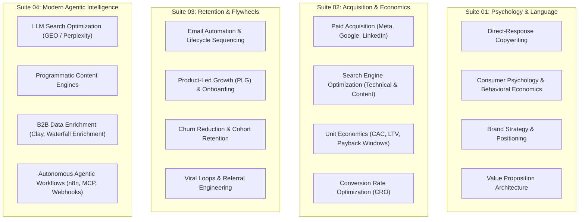

# Marketing Academy — Project Overview & Architecture Guide

> **A Practitioner's Field Manual for Growth, Unit Economics, and Distribution.**
> Designed as an interactive marketing laboratory, not a static slide deck.

---

## 1. Executive Summary & Mission

**Marketing Academy** is a free, vendor-neutral, open-access educational platform built to teach 24 core disciplines of digital marketing, growth, and modern AI automation. 

### Why This Project Exists
Most digital marketing advice online is written with a hidden commercial agenda: to sell software subscriptions, push $2,000 "guru" mastermind courses, or generate affiliate referral clicks. 

Marketing Academy was built to invert this model:
* **Zero Paywalls & Zero Form Gating:** Every lesson, quiz, and project is immediately accessible without requiring an account, email address, or credit card.
* **Empirical Research Only (AGENTS.md Rule 11):** Every strategy cites real numbers from verified sources (HubSpot, McKinsey, Statista, Basecamp, Stripe, Airbnb) rather than unverified opinion.
* **Micro-Paced for Real Life:** Lessons take 3 to 5 minutes to read and apply, designed to fit into a morning coffee routine.
* **Multilingual Commitment for Indian Learners (Rule 15):** Every lesson concludes with curated video resources in **Hindi**, **Tamil**, and **Telugu**, ensuring accessibility across linguistic backgrounds.

---

## 2. Key Platform Statistics

| Metric | Count | Details |
| :--- | :--- | :--- |
| **Unique Playbooks** | **642** | Peer-reviewed lessons spanning foundational to advanced levels |
| **Disciplines** | **24** | From SEO and Copywriting to Programmatic Growth and AI Agents |
| **Learning Tracks** | **24** | Structured career learning sequences with milestone completion |
| **Multilingual Resources** | **3 Languages** | Hindi (`hi`), Tamil (`ta`), and Telugu (`te`) in every single lesson |
| **Interactive Widgets** | **4+ Core Simulators** | Real-time ROAS sliders, Copywriting diagnostic scorer, Dilemma tests |
| **Gamification Habit** | **Streak Freezes** | Automatic loss-aversion streak shield engine protecting learner habits |

---

## 3. The 4 Curriculum Suites (24 Disciplines)

---

## 4. The Interactive Marketing Lab: Design System

The platform's frontend is built around an **Interactive Marketing Lab** paradigm rather than an encyclopedic blog:

### The 3 Signature Colors
1. **Paper White (`#FAF9F6`):**
   * Unbleached, warm literary paper stock mimicking physical book stock.
   * Completely eliminates eye fatigue and sterile digital glare.
2. **Light Blue (`#3B82F6` & `#EBF3FC`):**
   * Soft sky highlight washes and active parameter slider fills.
   * High-contrast focus cues and daily habit badges.
3. **Deep Midnight Ink (`#0F1B2B`):**
   * Authoritative, aristocratic dark blue-black for structural borders.
   * Powers the 3D tactile pushable buttons and Fraunces serif typography.

### Typography Hierarchy
* **Headings:** *Fraunces* (Soft-serif variable display font with organic, human warmth).
* **Body & UI:** *DM Sans* / *Public Sans* (Low-contrast, highly legible humanist sans-serif).
* **Data & Metrics:** *JetBrains Mono* / *IBM Plex Mono* (Precision financial and statistical readouts).

### Pedagogical Interaction Design
* **The Breakeven Simulator:** Lets learners slide landing page conversion rate (CVR) and watch Customer Acquisition Cost (CAC) and net margin recalculate live in sub-100ms.
* **The Copywriting Clinic:** Evaluates headline drafts in real time for specific numbers, power verbs, and word pacing.
* **The Daily Case Dilemma:** A/B test dilemma (e.g., Basecamp CTA phrasing) that teaches behavioral psychology through prediction and instant reveal.
* **Streak Shield Protection:** Endowed streak freeze protection that guards learner momentum when life gets busy.

---

## 5. Technical Architecture

* **Framework:** Next.js 16 (App Router) with React 19.
* **Styling:** Tailwind CSS with CSS Variables for theme adaptability (Dark/Light).
* **Content:** `@next/mdx` with custom globally-registered components (`Callout`, `Mermaid`, `Quiz`, `ResourceList`, `RoasCalculator`, `HeadlineTester`).
* **State Management:** Custom React hooks (`useEngagement`, `useLessonProgress`) backed by localStorage event buses (`ma_engagement`, `ma_quiz_pass`).
* **Test Suite:** Native Node.js test runner (`node --import tsx --test tests/*.test.ts`) with 75/75 passing tests verifying referential integrity, progress event firing, and API security gates.

---

*© 2026 Marketing Academy. Free and Open Source Educational Resource.*
