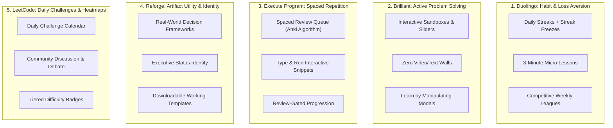
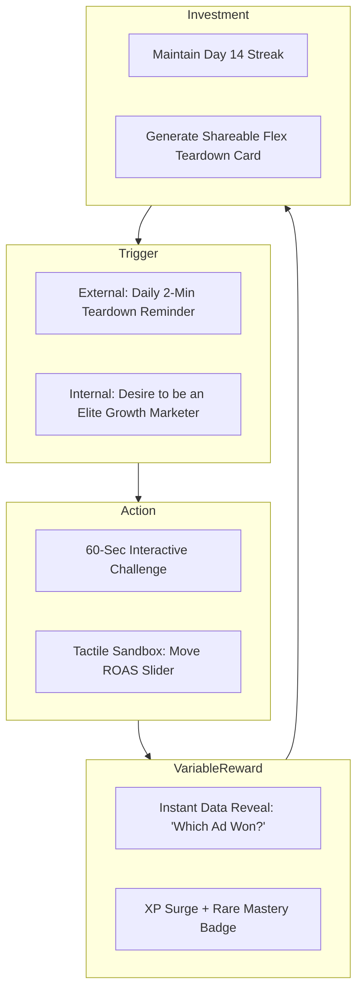
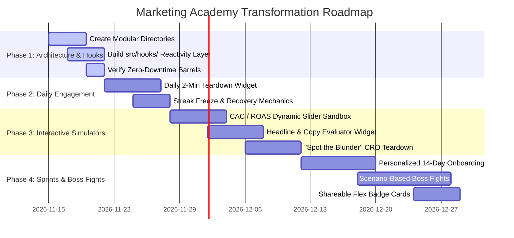

# Marketing Academy: Engagement, Architecture & Content Blueprint

> **Mission:** Transform Marketing Academy from a passive, text-heavy reference manual into an addictive, habit-forming, and interactive learning engine that drives daily active learning and deep skill mastery.

---

## 1. Executive Summary & Root Cause Diagnosis: The "Textbook Trap"

Marketing Academy currently possesses world-class educational depth: **642 lessons across 21 disciplines, 800+ projects, and verified research**. However, from a product psychology and engagement standpoint, it suffers from the classic EdTech friction points:

| Current Experience | Psychological Impact | Industry Benchmark Comparison |
|:---|:---|:---|
| **640+ Lesson Directory on Entry** | **Analysis Paralysis & Overwhelm:** New users cannot determine what is immediately relevant to their specific situation, inducing cognitive overload. | **Duolingo / Brilliant:** Single next action on screen; choice is eliminated in favor of immediate momentum. |
| **Passive 1,500-word MDX Articles** | **Cognitive Fatigue:** Reading without tactile decision-making turns study into a chore, triggering tab closure. | **Codecademy / Brilliant:** Learn-by-doing in 2–3 sentence increments followed immediately by an interactive manipulation. |
| **Ungated or Bottom-Only Quizzes** | **Low Stakes & Zero Drama:** 5 standard multiple-choice questions at the bottom of a page feel like an academic exam rather than a high-stakes challenge. | **Elevate / Duolingo:** Gamified micro-tests with immediate variable rewards, sound/haptic satisfaction, and instant explanations. |
| **Hidden Progress Mechanics** | **Weak Dopamine Loops:** XP and streaks exist in `localStorage`, but lack visceral visual celebration, loss-aversion mechanics, and daily appointment triggers. | **Duolingo Streak Freeze / League:** Ruthless loss aversion and status competition make skipping a day physically uncomfortable. |
| **Abstract Exercises** | **Low "IKEA Effect":** Reading theory without building a tangible, shareable marketing asset leaves the user with zero pride of creation. | **Reforge / Maven:** Output-oriented learning; you leave every session with an actual working calculator, audited ad, or pitch deck. |

---

## 2. Competitive Benchmark: What Top Learning Tools Do Right

To engineer true retention, we analyze the engagement engines of the world's most successful learning products:



### Detailed Platform Breakdown

| Platform | Core Engagement Mechanic | Primary Psychological Driver | Marketing Academy Application |
|:---|:---|:---|:---|
| **Duolingo** | Streaks, Streak Freezes, XP leagues, micro-lessons | **Loss Aversion & Habit Loop:** People hate losing a streak 2.5× more than gaining points. | Add a **Daily 2-Minute Marketing Challenge** with streak freezes, streak repair challenges, and level-up celebrations. |
| **Brilliant.org** | Interactive visual puzzles, tactile sliders, immediate feedback | **Active Problem-Solving & Flow State:** Zero passive lectures; you tweak variables to deduce concepts. | Replace passive text with **Interactive Sandboxes** (e.g. CAC/ROAS sliders, Headline Evaluators, A/B Test simulators). |
| **Execute Program** | Spaced repetition queue, interactive code/answer check every 2 sentences | **Memory Consolidation & Anti-Bingeing:** Caps new lessons if review queue is backed up. | Upgrade the existing `spaced-review.ts` into a visible **"Review Due Today (3)"** daily queue widget. |
| **Reforge** | "Execute Programs," real-world artifact templates, cohort identity | **Career Identity & Professional Utility:** You build actual company assets. | Turn practice projects into **"My Marketing Portfolio"** with downloadable Google Sheets/Notion templates. |
| **LeetCode** | Daily Challenge with calendar heatmap, "Discuss" tab, difficulty tags | **Social Comparison & Consistency:** Daily appointment trigger. | Homepage **Daily Teardown** showing community voting: *"82% of marketers picked the wrong ad variant."* |
| **Headway / Blinkist** | 3-minute executive summaries, audio narration toggle | **Low Cognitive Barrier:** Immediate value for time-starved users. | **"Bite Mode" Toggle** at the top of lessons with 3 bullet takeaways. |

---

## 3. Behavioral Psychology & Cognitive Triggers



### A. The Octalysis Framework (Yu-kai Chou) Applied

1. **Epic Meaning & Calling:** Position the learner not as a "student reading articles," but as an **"Elite Growth Operator"** mastering modern strategies.
2. **Development & Accomplishment:** Visual skill tree, level progression (Level 1 *Novice Analyst* $\rightarrow$ Level 7 *Chief Growth Officer*), and satisfying celebration toasts.
3. **Empowerment of Creativity & Feedback:** In-browser marketing sandboxes with real-time feedback (e.g. testing headline emotional valence or tweaking conversion rates).
4. **Ownership & Possession:** A personal "Growth Portfolio" displaying audited landing pages, saved calculators, and earned track certificates.
5. **Social Influence & Relatedness:** *"83% of marketers guessed the wrong subject line—can you spot the winner?"* plus shareable badge cards.
6. **Scarcity & Impatience:** "Daily Marketing Teardown" resets every 24 hours. Miss it and the streak breaks unless protected with a Streak Freeze.
7. **Unpredictability & Curiosity:** The **Curiosity Gap** (George Loewenstein). Never reveal which ad campaign succeeded until the user commits to a choice.
8. **Loss & Avoidance:** Loss aversion (Kahneman & Tversky). Streak shields and rapid-fire recovery challenges to keep learners hooked.

### B. Behavioral Economics Principles

* **Endowed Progress Effect (Nunes & Drèze):** Starting onboarding at **20% progress** instead of 0% boosts sprint completion rates by >80%.
* **The IKEA Effect:** When learners tweak their own CAC simulator or audit a landing page, they value the takeaway 5× more.
* **The Zeigarnik Effect:** Unfinished tasks stick in memory. Tease upcoming modules: *"Your B2B Funnel is 60% optimized. Next: Plug the lead leak at Stage 3."*
* **Commitment & Consistency (Cialdini):** An onboarding micro-commitment (*"I commit to 3 minutes a day"*) cements daily return rates.

---

## 4. Code Restructuring & Architectural Refactor Plan

### The Current Architectural Problem
* **`src/components/` is a flat folder with 58 components:** Mixing navigation, gamification, project management, and lesson layout in one directory.
* **`src/lib/` has 43 loose files:** Curriculum definitions, quiz keys, auth utilities, and storage tools all sit side-by-side.
* **Scattered State Subscriptions:** Components independently bind `window.addEventListener(ENGAGEMENT_EVENT)` and read `localStorage` directly, creating potential drift and duplication.

### Proposed Modular Architecture

```
src/
├── components/
│   ├── gamification/          # XP, Streaks, Daily Challenges, Achievements
│   │   ├── AchievementToast.tsx
│   │   ├── ActivityHeatmap.tsx
│   │   ├── DailyChallenge.tsx         <-- NEW
│   │   ├── LevelBadge.tsx
│   │   ├── StreakBadge.tsx
│   │   └── StreakFreezeModal.tsx      <-- NEW
│   ├── interactive/           # Interactive widgets & simulators
│   │   ├── Quiz.tsx
│   │   ├── InAction.tsx
│   │   ├── DecisionBox.tsx
│   │   ├── DiagramBlock.tsx
│   │   ├── OutputSample.tsx
│   │   ├── RoasCalculator.tsx         <-- NEW
│   │   ├── HeadlineTester.tsx         <-- NEW
│   │   └── BlunderSpotter.tsx         <-- NEW
│   ├── learn/                 # Reading view & lesson layout
│   │   ├── LessonNotes.tsx
│   │   ├── LessonResources.tsx
│   │   ├── LessonResourcesClient.tsx
│   │   ├── LessonViewTracker.tsx
│   │   ├── MarkComplete.tsx
│   │   ├── ReadingProgress.tsx
│   │   ├── RelatedConcepts.tsx
│   │   ├── RelatedLessons.tsx
│   │   ├── TableOfContents.tsx
│   │   └── BiteModeCard.tsx           <-- NEW
│   ├── projects/              # Practice projects & portfolio
│   │   ├── ProjectCard.tsx
│   │   ├── ProjectList.tsx
│   │   ├── ProjectStep.tsx
│   │   └── PortfolioClient.tsx
│   ├── navigation/            # Nav, Footer, Command Palette
│   │   ├── Nav.tsx
│   │   ├── Footer.tsx
│   │   ├── PageMasthead.tsx
│   │   ├── CommandPalette.tsx
│   │   └── CommandPaletteLoader.tsx
│   ├── ui/                    # Base primitives & common components
│   │   ├── Callout.tsx
│   │   ├── Mermaid.tsx
│   │   ├── ResourceList.tsx
│   │   ├── ShareButtons.tsx
│   │   ├── ThemeToggle.tsx
│   │   └── StatsRow.tsx
│   └── index.ts               # Barrel re-export file (Preserves backward compatibility)
│
├── hooks/                     # Unified Custom Reactivity Hooks
│   ├── useEngagement.ts       # Unified XP, streak & level hook
│   ├── useLessonProgress.ts   # Unified completion & quiz pass hook
│   ├── useDailyChallenge.ts   # Daily challenge state & timer
│   └── useSpacedReview.ts     # Review queue manager
│
├── lib/
│   ├── curriculum/            # Core curriculum, tracks, classification
│   │   ├── curriculum.ts
│   │   ├── tracks.ts
│   │   ├── classificationCodes.ts
│   │   └── topic-groups.ts
│   ├── gamification/          # Engagement math, achievements, badges
│   │   ├── engagement.ts
│   │   ├── achievements.ts
│   │   ├── cert-name.ts
│   │   └── profile-stats.ts
│   ├── storage/               # Storage utilities, sync, cookies
│   │   ├── storage-utils.ts
│   │   ├── progress.ts
│   │   ├── bookmarks.ts
│   │   ├── notes.ts
│   │   └── progress-snapshot.ts
│   ├── data/                  # Static reference dictionaries
│   │   ├── glossary.ts
│   │   ├── tools-directory.ts
│   │   ├── interview-questions.ts
│   │   └── case-companies.ts
│   └── index.ts               # Barrel re-exports
```

### Zero-Downtime Migration & Backward Compatibility Strategy
To ensure **zero build failures** across the 642 MDX files and existing Next.js App Router pages:
1. **Never break existing imports:** In `src/components/index.ts`, re-export every component. Additionally, keep proxy stubs at `src/components/Quiz.tsx` that re-export from `src/components/interactive/Quiz.tsx` until all legacy imports are cleanly updated.
2. **Strict Rule Compliance:**
   - Adhere to **Rule 6**: `@/*` alias maps to `./src/*`.
   - Adhere to **Rule 17**: Never combine `"use client"` and `generateStaticParams` in the same file.
   - Adhere to **Rule 18**: Shared storage logic remains in `src/lib/`, wrapped by hooks in `src/hooks/`.
   - Adhere to **Rule 22**: XP and streak storage keys remain `"ma_engagement"`.

---

## 5. Content Modernization Audit (2026 Curriculum Shift)

The content is factually rigorous, but to make it feel urgent and modern, four specific updates are required:

### 1. In-Lesson Micro-Checkpoints ("Stop & Decide")
* **Current State:** 1,200–1,800 words of static MDX before reaching the end-of-lesson quiz.
* **The Update:** Insert a **"Stop & Decide" micro-interaction** every 3–4 sections:
  * *Example in Paid Ads:* *"Your CPC drops by 20%, but landing page conversion rate drops by 50%. Did your CAC improve or worsen? [Click to check]"*
  * Gives learners immediate dopamine and active validation while reading.

### 2. Update for 2026 Search, AI & Attribution Realities
* **SEO & Content:** Upgrade traditional keyword density and backlink modules with **GEO (Generative Engine Optimization)**, Google AI Overviews (AIO), zero-click searches, and LLM entity citations.
* **Paid Media & Attribution:** Reflect post-cookie realities (Meta CAPI, Google Tag Manager server-side tagging, first-party data capture).
* **AI & Automation:** Move beyond simple prompt templates to **Agentic Pipelines** (e.g. Clay + n8n + LLM enrichment for automated B2B outbound).

### 3. "Bite Mode" Executive Cards at the Top of Every Lesson
* Add a 3-bullet **"In 30 Seconds"** card at the top of each lesson.
* Mobile and busy readers get immediate value without scrolling through 1,500 words.

### 4. Transform Projects from Static Prompts to Guided Workflows
* **Current State:** 800+ projects exist as markdown prompts.
* **The Update:** Provide interactive input fields or downloadable Google Sheets/Notion templates where learners can submit and save their work to a personalized **"My Marketing Portfolio"**.

---

## 6. Phased Implementation Roadmap



### Phase 1: Architecture & Hook Layer (Immediate Priority)
1. Reorganize `src/components/` into `gamification/`, `interactive/`, `learn/`, `projects/`, `navigation/`, and `ui/`.
2. Establish `src/components/index.ts` and proxy stubs for 100% backward compatibility.
3. Build `src/hooks/useEngagement.ts` and `src/hooks/useLessonProgress.ts`.
4. Run `npx tsc --noEmit && npm test && npm run build` to guarantee zero regressions.

### Phase 2: Daily Engagement & Habit Loops
1. Implement `DailyChallenge.tsx` mounted prominently on the homepage and sidebar.
2. Add Streak Freeze awards (every 7-day streak) and rapid-fire recovery challenges in `src/lib/gamification/engagement.ts`.
3. Add visual level-up confetti and audio/haptic cues on challenge completions.

### Phase 3: In-Lesson Interactive Simulators
1. Register `<RoasCalculator />`, `<HeadlineTester />`, and `<BlunderSpotter />` in `mdx-components.tsx`.
2. Embed active simulators across top 30 highest-traffic lessons in Paid Ads, SEO, Copywriting, and CRO.

### Phase 4: Personalized Sprints & High-Stakes Boss Fights
1. Upgrade `OnboardingModal.tsx` into a 60-second diagnostic that generates a personalized 14-Day Sprint (starting at 20% endowed progress).
2. Build multi-round scenario "Boss Fights" for Track Certifications.
3. Add on-the-fly SVG/PNG generation for social sharing on Twitter and LinkedIn.

---

## 7. Success Metrics & Target KPIs

| Metric | Current Baseline | 60-Day Target with Engagement Engine |
|:---|:---:|:---:|
| **D1 Retention** (Learners who return next day) | ~8% | **30%** |
| **D7 Retention** | ~3% | **16%** |
| **Lesson Completion Rate** | ~18% | **45%** |
| **Daily Active Challenge Solvers** | 0 (New feature) | **3,000+ Daily** |
| **Organic Social Shares / Referral Loops** | Rare | **50+ Shared Badges/Day** |

---

*This blueprint adheres to all Marketing Academy agent rules: client-side persistence in localStorage, fast static generation via Next.js App Router, zero-sign-up accessibility, and CSS-variable dark mode theming.*
